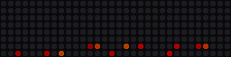

# Matrix-Klok

A WiFi clock with animations for an ESP32 and an 8x32 WS2812B LED matrix. It takes the time from NTP, keeps it in a DS3231 RTC (so it keeps running without WiFi), and switches between summer and winter time automatically (Europe/Amsterdam by default).

## Features

- **WiFi setup through WiFiManager.** On first boot, or when the setup access point is switched on, the clock opens the AP **`Matrix-Klok-Setup`**. Connect with a phone and pick your network (captive portal, or http://192.168.4.1).
- **NTP + DS3231 RTC.** Time is synced from NTP every 6 hours and stored in the DS3231 (in UTC). The colon pulses on the DS3231's 1 Hz SQW tick.
- **Screens:** time → time with seconds → date → temperature (from the DS3231). After 10 s the clock returns to the time.
- **Colour modes:** rainbow, colour cycle, warm white, cyan, orange, red, green, purple and blue. Brightness has 7 steps, with automatic night dimming (23:00–07:00).
- **Web GUI** on `http://<clock-ip>/` (also `http://matrix-klok.local/`):
  - Daily display timer: the display switches off between a set off time and on time. A button press wakes it for 30 s.
  - Toggle for the hourly shows.
  - **Restart** button.
  - Button that switches on the **setup access point**.
  - `GET /api/timer` returns the timer state as JSON.
- **Hourly shows.** Every full hour an 8-second animation plays, using the next effect in the rotation each time. There are no shows at night or while the display timer is off. The rotation position is saved in NVS.
- **OTA updates** over WiFi (ArduinoOTA, password protected).
- Settings (brightness, colour mode, timer, shows) survive a power loss.

### Show effects (13)

| # | Name | Effect | Preview |
|---|------|--------|---------|
| 1 | VUURWERK | Fireworks: rockets that burst into sparks |  |
| 2 | MATRIX | Green "digital rain" |  |
| 3 | STERREN | Twinkling coloured stars |  |
| 4 | REGENBOOG | Flowing rainbow waves (plasma) |  |
| 5 | SNEEUW | Falling snow that piles up |  |
| 6 | PACMAN | Pac-Man chases a ghost, then hunts blue ghosts |  |
| 7 | BALLEN | Bouncing balls with trails |  |
| 8 | VUUR | Calm fire |  |
| 9 | RUIMTE | Spaceship flying through a starfield with warp |  |
| 10 | ONWEER | Rain with mild lightning flashes |  |
| 11 | TETRIS | Blocks slide in and stack; full columns are cleared |  |
| 12 | SNAKE | Snake game that eats apples and grows |  |
| 13 | HART | Beating heart sliding across the screen |  |

The previews are rendered from the actual effect code in `src/main.cpp` with a small host simulator: the full 8-second show, logical 32x8 layout, at the real frame timing (shown at 25 or 16.7 fps). Colours are slightly boosted to look closer to real LEDs on a screen.

## Hardware

| Qty | Part |
|-----|------|
| 1 | ESP32 DevKit (30-pin, ESP32-WROOM-32) |
| 1 | WS2812B LED matrix, 8x32 (256 LEDs) |
| 1 | DS3231 RTC module (with a coin cell) |
| 3 | Push buttons (momentary) |
| 1 | 5 V 5 A power supply |
| 1 | 3D-printed enclosure |

## Pinout

| Function | ESP32 pin | Notes |
|----------|-----------|-------|
| LED matrix DIN | **GPIO 32** | Matrix 5V → 5 V supply, GND → common GND |
| Left button | **GPIO 26** | Other side to GND |
| Middle button | **GPIO 27** | Other side to GND |
| Right button | **GPIO 14** | Other side to GND |
| DS3231 SDA | **GPIO 21** | I²C |
| DS3231 SCL | **GPIO 22** | I²C |
| DS3231 SQW | **GPIO 4** | 1 Hz square wave (open drain) |
| DS3231 VCC / GND | **3V3** / GND | |
| Power | **VIN** (5 V) / GND | Same 5 V supply as the matrix |

Notes:

- **Buttons:** the firmware sets the button pins to `INPUT_PULLUP` and treats `LOW` as pressed. Wire each button between its GPIO and GND; no external resistors are needed.
- **SQW:** GPIO 4 also uses `INPUT_PULLUP`, because the DS3231's SQW output is open drain.
- **DS3231 power:** the code doesn't set this. Power the module from **3V3**, not 5 V. Most modules have I²C pull-ups to their own VCC, and 3.3 V keeps SDA/SCL at ESP32-safe levels.
- **Shared ground:** the ESP32, matrix and supply must share GND. Feed 5 V to the matrix directly from the supply, not through the ESP32.
- **Current limit:** brightness is limited in software to 1500 mA (`LED_MAX_MA` in `config.h`). The default brightness is low (20/255).

## Buttons

| Button | Short press | Long press (0.8 s) |
|--------|-------------|--------------------|
| Left | Previous screen | **Setup access point on/off** |
| Middle | Brightness (7 steps) | Next colour mode |
| Right | Next screen | **Play the next show** (and advance the rotation) |

- **Middle held 8 s:** clear the WiFi credentials and start the setup portal.
- **Left held during power-up:** matrix test pattern, to check the layout (see below).

## Configuration (`include/config.h`)

Pins, brightness, night dimming, time zone, NTP servers, host name, AP name and timings are all in `include/config.h`. The matrix layout is set with four options:

| Option | Meaning |
|--------|---------|
| `COLUMN_MAJOR` | `1` = pixels run per column (typical 8x32 panel), `0` = per row |
| `SERPENTINE` | `1` = each next column/row reverses direction (zigzag) |
| `ORIGIN_BOTTOM_LEFT` | `1` = pixel 0 is bottom-left, `0` = pixel 0 is top-left |
| `MIRROR_X` | `1` = mirror horizontally (pixel 0 on the right) |

The defaults are `COLUMN_MAJOR 1`, `SERPENTINE 1`, `ORIGIN_BOTTOM_LEFT 0`, `MIRROR_X 0`. If the image is scrambled or mirrored, hold the left button while powering up. The test shows `TEST 1` with red top-left, green top-right, blue bottom-left and white bottom-right, then a runner that follows the wiring. Adjust the four options until it looks right.

## Building

Requires [PlatformIO](https://platformio.org/) (`pip install platformio`).

```sh
cp include/secrets.h.example include/secrets.h   # then set your own OTA password
pio run                                          # build
./tools/make_merged.sh                           # build + dist/ with a single merged bin
pio device monitor                               # serial log (115200 baud)
```

`include/secrets.h` is ignored by git. Without it the firmware still builds, but OTA is then **not** password protected, so always create it.

## Flashing

### First flash (USB)

1. Connect the ESP32 over USB.
2. Hold the **BOOT** button.
3. Start the flash:
   ```sh
   pio run -e esp32dev -t upload
   # or, with the merged bin from tools/make_merged.sh:
   python -m esptool --chip esp32 --port COM4 --baud 460800 write-flash 0x0 dist/matrix-klok-merged.bin
   ```
4. Release BOOT once you see `Writing at 0x...`.
5. Press **EN** (reset) if the board doesn't restart by itself.

The merged bin also overwrites NVS, so the settings and WiFi credentials are wiped.

### Updates over WiFi (OTA)

After the first flash the clock appears on your network as `matrix-klok` (`matrix-klok.local`).

- **PlatformIO:** `pio run -e ota -t upload`. `tools/ota_auth.py` reads the password from `include/secrets.h` automatically.
- **espota.py** (ships with the Arduino-ESP32 core):
  ```sh
  python espota.py -i <clock-ip> -p 3232 -P 34567 --auth=<your-ota-password> -f .pio/build/esp32dev/firmware.bin -r
  ```
  On Windows, allow inbound TCP on the host port (`-P 34567`) in the firewall if the upload stops with "No response from device".

During an OTA update the matrix shows a green progress bar.

## License

[MIT](LICENSE) © 2026 Leon (leon199219)
